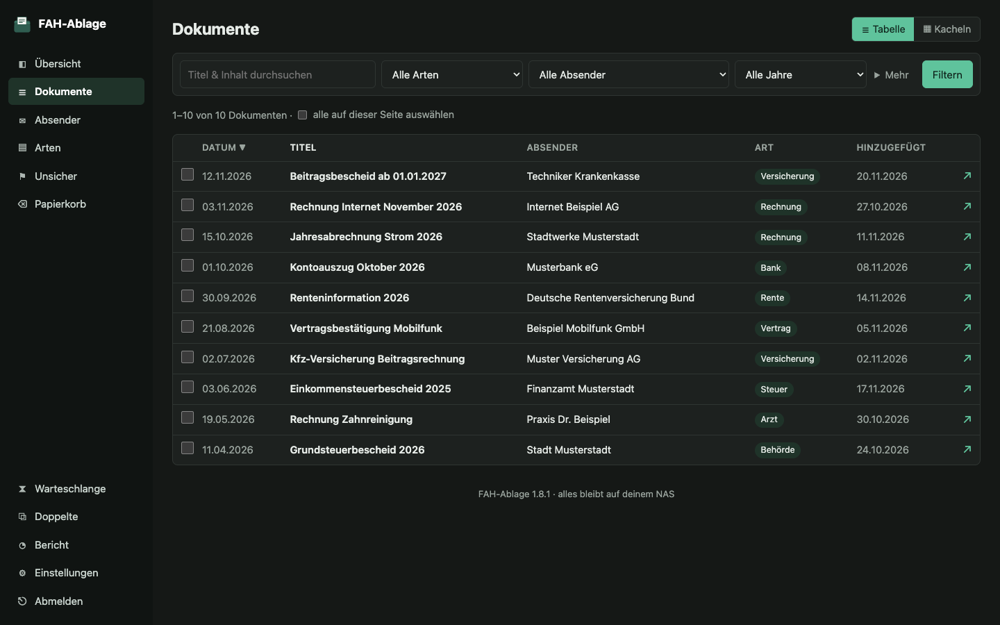
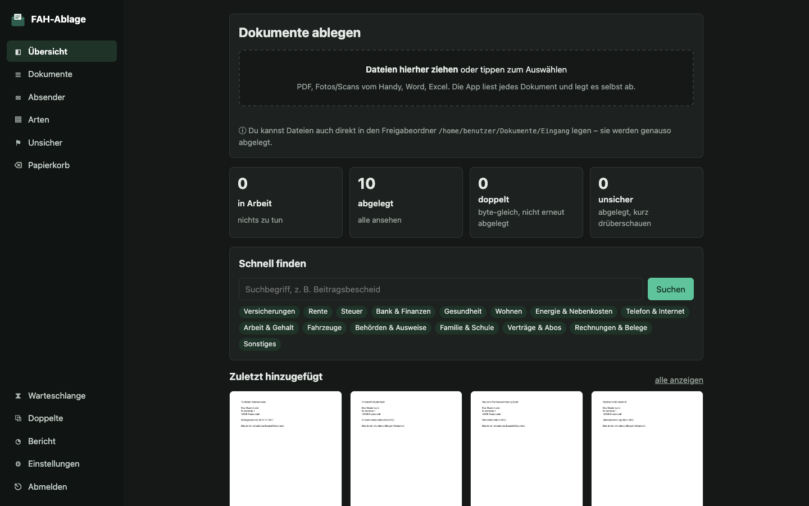
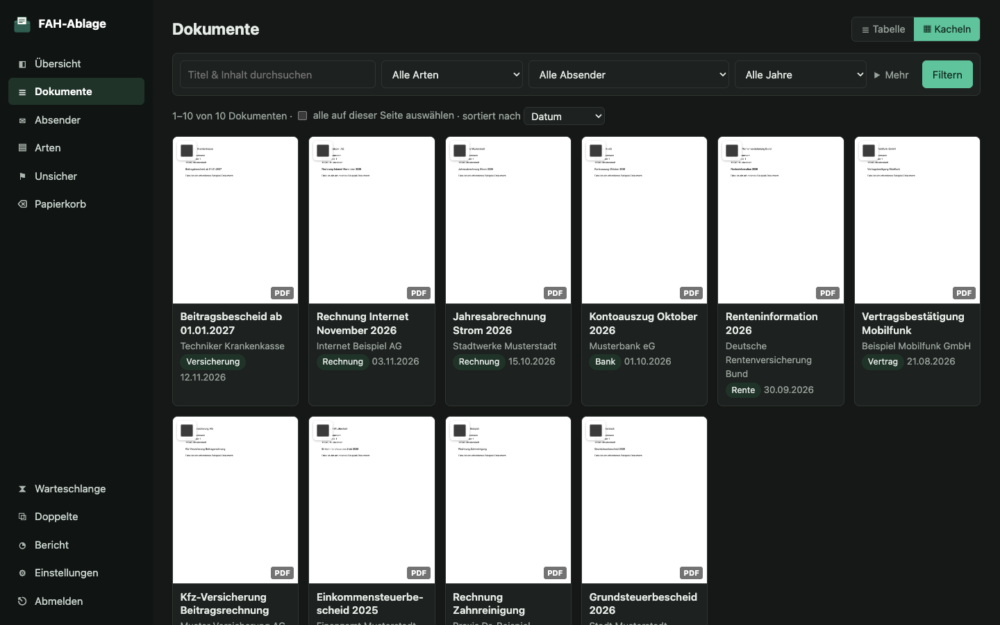
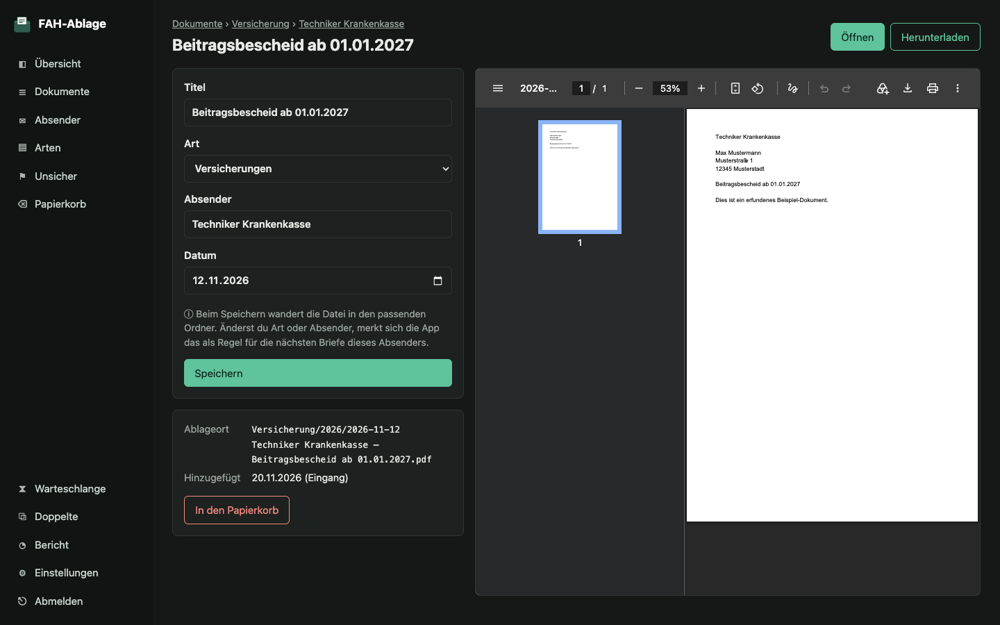
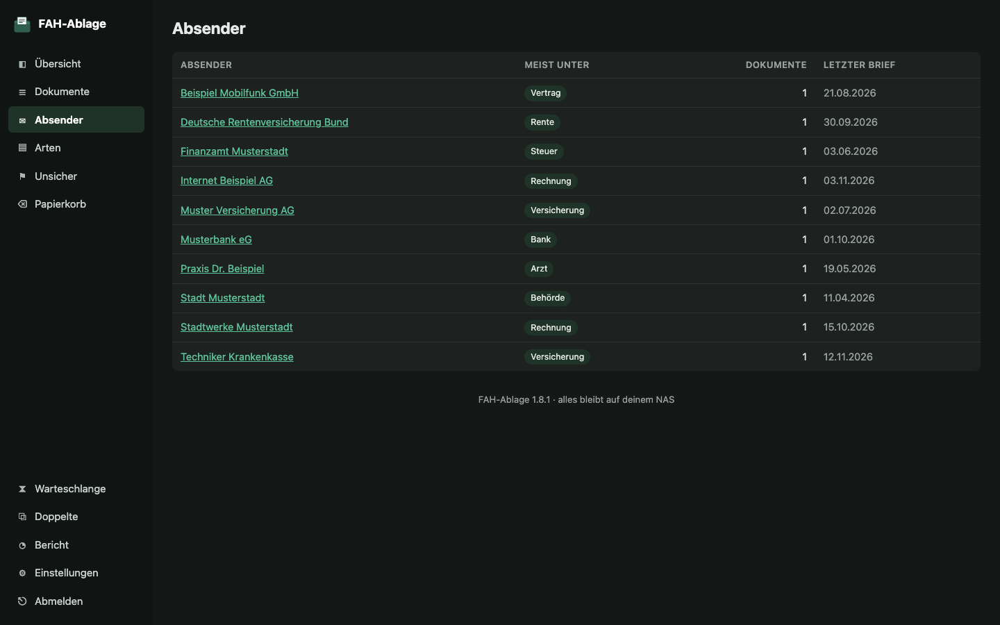
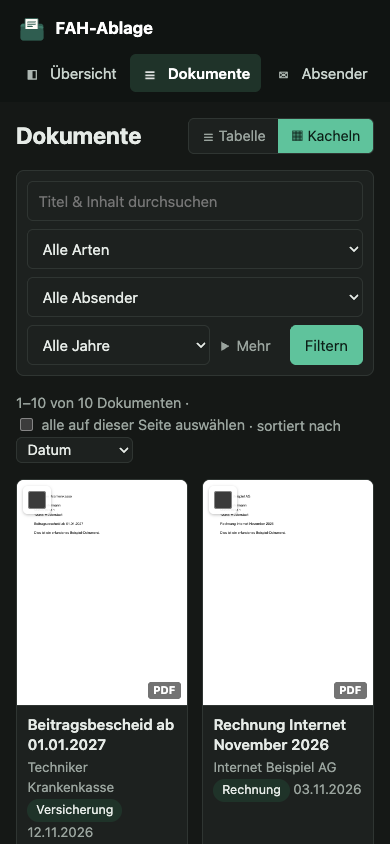

# FAH-Ablage

Dokumentenablage mit **lokaler KI** für das NAS oder MiniPC mit Docker. Dokumente einzeln in den Eingang legen
(Freigabeordner oder Upload in der Weboberfläche, auch vom Handy) – die App liest sie, erkennt Art,
Absender, Briefdatum und Titel und legt sie selbst ab:

    Versicherungen / TK / 2026 / 2026-11-12 Beitragsbescheid.pdf

Nichts verlässt das NAS: Texterkennung (tesseract/ocrmypdf, Deutsch) und Sprachmodell
(Qwen3-4B über llama.cpp) laufen in den eigenen Containern.

## Screenshots

*Aufgenommen mit erfundenen Beispielbriefen (an „Max Mustermann, Musterstadt“) – keine echten Dokumente oder Daten.*

| Übersicht | Kacheln |
|---|---|
|  |  |
| **Dokument mit Vorschau** | **Absender** |
|  |  |

## Bedienung
- **Übersicht:** Dateien hineinziehen oder antippen, Kacheln für „in Arbeit“, „abgelegt“, „unsicher“, Import.
- **Suche:** Volltext, Art, Absender, Zeitraum, Jahr-Schnellwahl, nur unsichere, Papierkorb.
- **Dokument:** Öffnen/Herunterladen, Art/Absender/Datum/Titel korrigieren → Datei wandert mit,
  die App merkt sich die Zuordnung als Regel (Absender → Art, Schreibweise → Absender).
- **Einstellungen:** Arten-Liste, Schwelle für „unsicher“, Ordner importieren (beliebiger Ordner im persönlichen Ordner, per Klick gewählt; Eingang/Archiv ausgenommen, Video/Musik übersprungen), gelernte Regeln.
- **Zweiter Blick:** Unsichere Dokumente werden ein zweites Mal angeschaut – erst mit fast gleichen, schon sicheren Dokumenten verglichen (≥ 2 Nachbarn, Ähnlichkeit ≥ 0,6, 80 % einig; gemessen 99,6 % richtig), dann von der KI mit mehr Text und diesen Vorbildern. Geklärte unter Dokumente → „vom zweiten Blick geklärt“.
- **Lohnzettel:** Titel immer „Gehaltsabrechnung <Monat> <Jahr>“ (Abrechnungsmonat aus dem Text).
- **Doppelte:** Liste aller byte-gleichen (SHA-256) Dateien, die nicht erneut abgelegt wurden, je abgelegtem Dokument; aufbewahrte Kopien aus dem Eingang herunterladen/löschen. Ähnliche Dokumente (Lohnzettel anderer Monat) sind nie „doppelt“.
- **Warteschlange:** was noch eingelesen wird, in Verarbeitungsreihenfolge (Eingang/Upload vor Import), „Import abbrechen“ je Ordner.
- **Bericht:** Ergebnis des Imports je altem Ordner (Einheitlichkeit, Anteil unsicher).
- **Prüfen:** Aus „Unsicher“ heraus öffnet „Speichern & weiter“ gleich das nächste unsichere Dokument.
- **Sicherung & Wiederherstellung** (Einstellungen): eine `.tar`-Datei mit Archiv, Datenbank (Arten,
  Absender, Korrekturen, Regeln, Volltext) und Einstellungen – ohne Zugang/Passwort. Wiederherstellen
  nur in eine leere Ablage (frische Installation), nichts wird überschrieben; die 3 neuesten bleiben liegen
  (`config/sicherungen/`). Zusätzlich sichert die FAH-Sicherung täglich 04:15 (Auftrag „FAH-Ablage“).

Abgelegt wird **immer**. „Unsicher“ ist nur eine Markierung (KI knapp, Sonstiges, kaum Text,
kein Datum, anders als frühere Briefe desselben Absenders, Datei nicht lesbar).

## Betrieb (NAS)
| | |
|---|---|
| Ordner | `/volume3/docker/fah-ablage` |
| WebGUI | `http://192.168.1.23:8093` (Port-Automatik in `manage.sh`) |
| Container | `fah-ablage` (Web + Arbeiter, uid 1000:10), `fah-ablage-ki` (llama.cpp, 2 Kerne, cpu_shares 256) |
| Netz | `172.16.41.0/24` fest |
| Eingang / Archiv | `/home/benutzer/Dokumente/Eingang`, `…/Ablage` |
| Import (nur lesend) | `QUELLEN_DIR` = `/home/benutzer`, Voreinstellung `IMPORT_DIR` = `…/Privat` |
| Daten | `config/` (SQLite, Zugang, Papierkorb, Dubletten), `modelle/qwen3-4b.gguf` (Kopie aus KnowSora) |

Update: `sh tools/baue_zip.sh` → `fah-ablage.zip` per `cat | ssh` nach `/volume3/docker/fah-ablage/`
→ `./manage.sh update`. `config/`, `modelle/`, `.env`, `docker-compose.yml` bleiben unberührt.

## Entwicklung
Tests lokal (ohne Docker): venv mit `app/requirements.txt` + `pytest`, dann `python -m pytest -q tests/`.
Kennzahlen des Probelaufs (nur Zahlen, nie Inhalte): `docker exec fah-ablage python3 /app/werkzeuge/probelauf_zahlen.py`.
Entwurf und Plan: `docs/superpowers/`.
